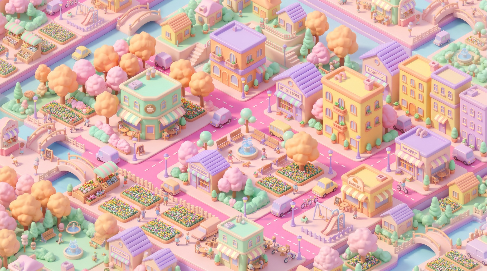

 

# Hi, I'm Lumenko! 🌸

**Building thoughtful digital things, one little detail at a time.**

*Curiosity, creativity, and a little pastel magic.* ✨

---

### 🌿 A little about me

I enjoy exploring ideas, learning new things, and making digital experiences feel a little more delightful. This is my corner of GitHub for experiments, projects, and things I'm excited to share.

### 🍑 What you'll find here

- **Projects** — things I'm building and refining.
- **Experiments** — small ideas worth trying.
- **Learning notes** — discoveries along the way.

### 🪻 Featured work

Take a look at my [repositories](https://github.com/lumenko?tab=repositories), or explore the projects pinned below this README.

---

**Made with curiosity, care, and a splash of color.** 🌷

Thanks for stopping by my little corner of the internet.

